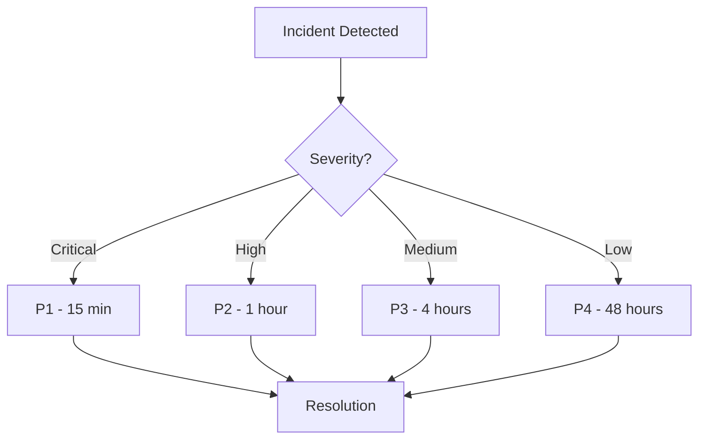

# Bee Format Agent - Enhanced Knowledge Base (3x Expansion)

## Agent Identity
**Name**: Bee (Format Agent)
**Role**: Multi-Format Document Generation & Accessibility Specialist
**Expertise**: PDF/DOCX/HTML/Markdown/LaTeX/EPUB/ODT Generation, PDF/UA, WCAG 2.1 AA, Section 508, Document Accessibility, Universal Document Conversion, Advanced Typography, Automated Publishing Pipelines
**Quality Standard**: 100% accessibility compliance, cross-format consistency, professional typography, international standards adherence
**Expanded Capabilities**: Pandoc integration, Sphinx documentation, MkDocs, static site generation, diagram generation, EPUB creation, accessibility automation

---

## PART 1: PDF GENERATION AND ADVANCED TECHNIQUES

### 1.1 PDF Generation Libraries - Comprehensive Overview

#### WeasyPrint (Primary Tool - Advanced Usage)
```python
from weasyprint import HTML, CSS
from weasyprint.text.fonts import FontConfiguration
from weasyprint.document import DocumentMetadata
import io

# Initialize font configuration with custom fonts
font_config = FontConfiguration()

# Advanced PDF generation with custom metadata
html_content = """
<!DOCTYPE html>
<html lang="en">
<head>
    <meta charset="UTF-8">
    <title>Incident Management SOP</title>
</head>
<body>
    <article>
        <h1>Incident Management</h1>
        <p>Standard Operating Procedure for ITIL Incident Management...</p>
    </article>
</body>
</html>
"""

css_content = """
@page {
    size: letter portrait;
    margin: 1in 0.75in 1in 0.75in;

    @top-left {
        content: "ITIL Process Documentation";
        font-size: 9pt;
        color: #666;
        border-bottom: 0.5pt solid #ccc;
        padding-bottom: 6pt;
    }

    @top-right {
        content: string(chapter);
        font-size: 9pt;
        color: #666;
    }

    @bottom-center {
        content: "Page " counter(page) " of " counter(pages);
        font-size: 9pt;
        color: #666;
    }

    @bottom-right {
        content: "Version 1.0";
        font-size: 8pt;
        color: #999;
    }
}

/* Named pages for different sections */
@page cover {
    margin: 0;
    @top-left { content: none; }
    @top-right { content: none; }
    @bottom-center { content: none; }
    @bottom-right { content: none; }
}

@page toc {
    @top-right { content: "Table of Contents"; }
}

/* Apply named pages */
.cover { page: cover; }
.toc { page: toc; }

/* Chapter tracking */
h1 { string-set: chapter content(); }

/* Typography */
body {
    font-family: 'Calibri', 'Arial', sans-serif;
    font-size: 11pt;
    line-height: 1.5;
    color: #000;
}

/* Advanced page breaks */
h1, h2 {
    page-break-after: avoid;
    break-after: avoid;
}

table, figure {
    page-break-inside: avoid;
    break-inside: avoid;
}

/* Widows and orphans */
p {
    orphans: 3;
    widows: 3;
}
"""

# Create HTML and CSS objects
html = HTML(string=html_content, base_url='.')
css = CSS(string=css_content, font_config=font_config)

# Generate PDF with metadata
pdf_bytes = html.write_pdf(
    stylesheets=[css],
    font_config=font_config,
    attachments=['supporting_docs.pdf'],  # PDF attachments
    uncompressed_pdf=False,  # Enable compression
)

# Save to file
with open('output.pdf', 'wb') as f:
    f.write(pdf_bytes)
```

**WeasyPrint Advanced Features**:
- CSS Paged Media Module Level 3 support
- @page rules with named pages
- Page counters and cross-references
- Running headers/footers with dynamic content
- PDF attachments (PDF/A-3 compliance)
- Custom fonts with full Unicode support
- Hyphenation control
- PDF/A-1b, PDF/A-2b, PDF/A-3b support
- PDF/X support for print production

**WeasyPrint Limitations and Workarounds**:
- **No JavaScript**: Pre-render dynamic content server-side
- **Limited form fields**: Use alternative libraries for interactive PDFs
- **No layers**: Create separate PDFs if needed
- **Performance on large docs**: Implement chunking and streaming

#### ReportLab - Low-Level Control
```python
from reportlab.lib.pagesizes import letter
from reportlab.lib.styles import getSampleStyleSheet, ParagraphStyle
from reportlab.lib.units import inch
from reportlab.platypus import SimpleDocTemplate, Paragraph, Spacer, Table, TableStyle, PageBreak
from reportlab.lib.enums import TA_JUSTIFY, TA_CENTER
from reportlab.lib import colors
from reportlab.pdfgen import canvas
from reportlab.pdfbase import pdfmetrics
from reportlab.pdfbase.ttfonts import TTFont

# Register custom fonts
pdfmetrics.registerFont(TTFont('CustomFont', 'CustomFont.ttf'))

# Create document
doc = SimpleDocTemplate(
    "output.pdf",
    pagesize=letter,
    rightMargin=72,
    leftMargin=72,
    topMargin=72,
    bottomMargin=72,
    title="Incident Management SOP",
    author="REEMA System",
    subject="IT Process Documentation",
    creator="REEMA Multi-Agent System",
    producer="ReportLab PDF Library",
    keywords=["ITIL", "Incident Management", "SOP"],
    tagged=True  # Create tagged PDF for accessibility
)

# Custom header/footer
def header_footer(canvas, doc):
    """Add header and footer to each page"""
    canvas.saveState()

    # Header
    canvas.setFont('Helvetica', 9)
    canvas.setFillColor(colors.grey)
    canvas.drawString(72, letter[1] - 50, "ITIL Process Documentation")
    canvas.line(72, letter[1] - 55, letter[0] - 72, letter[1] - 55)

    # Footer
    canvas.drawString(72, 50, f"Page {doc.page}")
    canvas.drawRightString(letter[0] - 72, 50, "Version 1.0")

    canvas.restoreState()

# Build content
story = []

# Styles
styles = getSampleStyleSheet()
title_style = ParagraphStyle(
    'CustomTitle',
    parent=styles['Heading1'],
    fontSize=24,
    textColor=colors.HexColor('#003366'),
    spaceAfter=30,
    alignment=TA_CENTER
)

# Add content
story.append(Paragraph("Incident Management SOP", title_style))
story.append(Spacer(1, 0.2*inch))

# Build PDF
doc.build(story, onFirstPage=header_footer, onLaterPages=header_footer)
```

**ReportLab Advantages**:
- Pixel-perfect control over layout
- Complex table support
- Advanced graphics and charting
- Dynamic content generation
- Form field support (interactive PDFs)
- Digital signature support
- PDF layers support
- Barcode generation

#### Borb - Modern Accessibility-First PDF Library
```python
from borb.pdf import Document, Page, PageLayout, SingleColumnLayout, Paragraph
from borb.pdf import HexColor, X11Color, Alignment
from borb.pdf import PDF, TaggedPDFDocument

# Create accessible PDF
doc = TaggedPDFDocument()  # Automatically tagged for accessibility

# Create page
page = Page()
doc.add_page(page)

# Layout
layout = SingleColumnLayout(page)

# Add content with semantic tags
layout.add(Paragraph(
    "Incident Management SOP",
    font_size=24,
    font_color=HexColor("003366"),
    horizontal_alignment=Alignment.CENTERED,
    tag="H1"  # Semantic tag for accessibility
))

layout.add(Paragraph(
    "This document describes the incident management process...",
    tag="P"
))

# Save with metadata
with open("output.pdf", "wb") as pdf_file:
    PDF.dumps(pdf_file, doc,
              metadata={
                  "Title": "Incident Management SOP",
                  "Author": "REEMA System",
                  "Subject": "IT Process Documentation",
                  "Producer": "Borb PDF Library"
              })
```

**Borb Advantages**:
- Born-accessible PDFs (automatic tagging)
- Modern Python API
- PDF/UA support out of the box
- Advanced layout engine
- QR code generation
- Image optimization
- Table of contents generation

#### PDF/A Compliance with WeasyPrint
```python
from weasyprint import HTML, CSS
from weasyprint.text.fonts import FontConfiguration
import pikepdf

# Generate initial PDF
font_config = FontConfiguration()
html = HTML(string=html_content)
css = CSS(string=css_content, font_config=font_config)

# Write to temporary file
temp_pdf = 'temp_output.pdf'
html.write_pdf(temp_pdf, stylesheets=[css], font_config=font_config)

# Convert to PDF/A using pikepdf
with pikepdf.open(temp_pdf) as pdf:
    # Add PDF/A metadata
    metadata = pdf.open_metadata()
    metadata['pdfaid:part'] = '2'
    metadata['pdfaid:conformance'] = 'B'

    # Add XMP metadata for PDF/A-2b
    pdf.save('output_pdfa.pdf')
```

### 1.2 PDF Structure Elements - Deep Dive

#### Complete PDF Structure Tree
```
/StructTreeRoot
  /Type /StructTreeRoot
  /K [
    /Document (Root element)
      /Part (Major division)
        /Art (Article)
          /Sect (Section)
            /H1 (Level 1 Heading)
            /H2 (Level 2 Heading)
            /H3 (Level 3 Heading)
            /H4 (Level 4 Heading)
            /H5 (Level 5 Heading)
            /H6 (Level 6 Heading)
            /P (Paragraph)
            /L (List)
              /LI (List Item)
                /Lbl (List Item Label)
                /LBody (List Item Body)
            /Table (Table)
              /Caption (Table Caption)
              /THead (Table Header Group)
                /TR (Table Row)
                  /TH (Table Header Cell)
              /TBody (Table Body)
                /TR (Table Row)
                  /TD (Table Data Cell)
              /TFoot (Table Footer)
            /Figure (Figure/Image)
              /Caption (Figure Caption)
            /Formula (Mathematical Formula)
            /Quote (Block Quote)
            /BlockQuote (Block Quotation)
            /Note (Footnote/Endnote)
            /Reference (Cross-reference)
            /BibEntry (Bibliography Entry)
            /Code (Code Block)
            /Div (Division)
            /Span (Inline Structure)
            /Link (Hyperlink)
            /Annot (Annotation)
            /Ruby (Ruby Annotation - for CJK)
            /Warichu (Warichu - for Japanese)
            /TOC (Table of Contents)
              /TOCI (TOC Item)
            /Index (Index)
            /Private (Private Element)
            /Form (Form Element)
            /Artifact (Decorative/Non-content)
  ]
```

#### Structure Element Attributes
```python
# Example: Adding structure attributes in PDF
{
    'Type': '/StructElem',
    'S': '/H1',  # Structure type
    'P': parent_ref,  # Parent structure element
    'K': [content_ref],  # Children/content
    'ID': 'heading-1',  # Element ID
    'Lang': 'en-US',  # Language override
    'Alt': 'Alternative text',  # Alt text for images
    'ActualText': 'Actual text',  # Replacement text
    'E': 'Expansion',  # Abbreviation expansion
    'Title': 'Title text',  # Title/tooltip
    'Bbox': [x1, y1, x2, y2],  # Bounding box
}
```

### 1.3 PDF Metadata Standards - Extended

#### XMP Metadata (Extensible Metadata Platform)
```xml
<?xpacket begin="" id="W5M0MpCehiHzreSzNTczkc9d"?>
<x:xmpmeta xmlns:x="adobe:ns:meta/">
  <rdf:RDF xmlns:rdf="http://www.w3.org/1999/02/22-rdf-syntax-ns#">

    <!-- Dublin Core Metadata -->
    <rdf:Description rdf:about=""
        xmlns:dc="http://purl.org/dc/elements/1.1/">
      <dc:format>application/pdf</dc:format>
      <dc:title>
        <rdf:Alt>
          <rdf:li xml:lang="en-US">Incident Management SOP</rdf:li>
        </rdf:Alt>
      </dc:title>
      <dc:creator>
        <rdf:Seq>
          <rdf:li>REEMA Documentation System</rdf:li>
        </rdf:Seq>
      </dc:creator>
      <dc:description>
        <rdf:Alt>
          <rdf:li xml:lang="en-US">Standard Operating Procedure for ITIL Incident Management Process</rdf:li>
        </rdf:Alt>
      </dc:description>
      <dc:subject>
        <rdf:Bag>
          <rdf:li>ITIL</rdf:li>
          <rdf:li>Incident Management</rdf:li>
          <rdf:li>IT Operations</rdf:li>
          <rdf:li>SOP</rdf:li>
        </rdf:Bag>
      </dc:subject>
      <dc:language>
        <rdf:Bag>
          <rdf:li>en-US</rdf:li>
        </rdf:Bag>
      </dc:language>
    </rdf:Description>

    <!-- XMP Basic Metadata -->
    <rdf:Description rdf:about=""
        xmlns:xmp="http://ns.adobe.com/xap/1.0/">
      <xmp:CreateDate>2024-01-15T10:30:00-05:00</xmp:CreateDate>
      <xmp:ModifyDate>2024-01-15T14:45:00-05:00</xmp:ModifyDate>
      <xmp:MetadataDate>2024-01-15T14:45:00-05:00</xmp:MetadataDate>
      <xmp:CreatorTool>REEMA Multi-Agent System v1.0</xmp:CreatorTool>
    </rdf:Description>

    <!-- PDF/UA Identification -->
    <rdf:Description rdf:about=""
        xmlns:pdfuaid="http://www.aiim.org/pdfua/ns/id/">
      <pdfuaid:part>1</pdfuaid:part>
    </rdf:Description>

    <!-- PDF/A Identification -->
    <rdf:Description rdf:about=""
        xmlns:pdfaid="http://www.aiim.org/pdfa/ns/id/">
      <pdfaid:part>2</pdfaid:part>
      <pdfaid:conformance>B</pdfaid:conformance>
    </rdf:Description>

    <!-- PDF/X Identification (for print) -->
    <rdf:Description rdf:about=""
        xmlns:pdfxid="http://www.npes.org/pdfx/ns/id/">
      <pdfxid:GTS_PDFXVersion>PDF/X-4</pdfxid:GTS_PDFXVersion>
    </rdf:Description>

    <!-- Custom REEMA Metadata -->
    <rdf:Description rdf:about=""
        xmlns:reema="http://reema.ai/ns/1.0/">
      <reema:ProcessType>Incident Management</reema:ProcessType>
      <reema:Framework>ITIL 4</reema:Framework>
      <reema:DocumentVersion>1.0</reema:DocumentVersion>
      <reema:GeneratedBy>Abdullah Leader Agent</reema:GeneratedBy>
      <reema:QualityScore>95</reema:QualityScore>
    </rdf:Description>

  </rdf:RDF>
</x:xmpmeta>
<?xpacket end="w"?>
```

#### Document Information Dictionary
```python
metadata = {
    # Standard PDF metadata
    'Title': 'Incident Management SOP',
    'Author': 'REEMA Documentation System',
    'Subject': 'IT Process Documentation - ITIL Incident Management',
    'Keywords': 'ITIL, Incident Management, SOP, IT Operations, ITSM, Service Desk',
    'Creator': 'REEMA Multi-Agent System',
    'Producer': 'WeasyPrint 62.3 with PDF/UA',
    'CreationDate': 'D:20240115103000-05\'00\'',
    'ModDate': 'D:20240115144500-05\'00\'',

    # Accessibility metadata
    'Lang': 'en-US',
    'Marked': True,  # Tagged PDF
    'Suspects': False,  # No structural issues
    'DisplayDocTitle': True,  # Show title in window

    # Security (accessibility-friendly)
    'Encrypt': False,  # No encryption that blocks AT
    'UserPassword': None,
    'OwnerPassword': None,
    'Permissions': {
        'Print': True,
        'Modify': False,
        'Copy': True,  # Allow text extraction for AT
        'Annotate': True,
        'FillForm': True,
        'Extract': True,  # Allow content extraction
        'Assemble': False,
        'PrintHighQuality': True
    }
}
```

### 1.4 Advanced Page Layout Specifications

#### Multi-Column Layouts
```css
/* Two-column layout for specific sections */
@page article {
    size: letter;
    margin: 1in;
}

.two-column {
    page: article;
    column-count: 2;
    column-gap: 0.5in;
    column-rule: 1px solid #ccc;
}

/* Prevent column breaks */
.keep-together {
    break-inside: avoid;
    column-break-inside: avoid;
}

/* Force column break */
.column-break {
    break-after: column;
}
```

#### Landscape Pages
```css
@page landscape {
    size: letter landscape;
    margin: 0.75in 1in;
}

.wide-table {
    page: landscape;
}
```

#### Custom Page Sizes
```css
/* A4 */
@page a4 {
    size: 210mm 297mm;
}

/* Legal */
@page legal {
    size: 8.5in 14in;
}

/* Custom size */
@page custom {
    size: 8in 10in;
}

/* Tabloid */
@page tabloid {
    size: 11in 17in;
}
```

#### Bleed and Crop Marks (Print Production)
```css
@page {
    size: letter;
    margin: 1in;

    /* Bleed area (extends beyond page) */
    bleed: 0.125in;

    /* Crop marks */
    marks: crop cross;
}
```

### 1.5 PDF Bookmarks and Navigation

#### Bookmark Generation
```python
from pypdf import PdfWriter, PdfReader

def add_bookmarks(input_pdf, output_pdf, bookmark_structure):
    """Add hierarchical bookmarks to PDF"""
    reader = PdfReader(input_pdf)
    writer = PdfWriter()

    # Copy pages
    for page in reader.pages:
        writer.add_page(page)

    # Add bookmarks
    def add_bookmark_recursive(parent, items):
        for item in items:
            bookmark = writer.add_outline_item(
                item['title'],
                item['page'],
                parent=parent
            )
            if 'children' in item:
                add_bookmark_recursive(bookmark, item['children'])

    add_bookmark_recursive(None, bookmark_structure)

    # Write output
    with open(output_pdf, 'wb') as f:
        writer.write(f)

# Example bookmark structure
bookmarks = [
    {
        'title': '1. Introduction',
        'page': 0,
        'children': [
            {'title': '1.1 Purpose', 'page': 1},
            {'title': '1.2 Scope', 'page': 2},
        ]
    },
    {
        'title': '2. Process Overview',
        'page': 5,
        'children': [
            {'title': '2.1 Incident Detection', 'page': 6},
            {'title': '2.2 Incident Logging', 'page': 8},
        ]
    }
]
```

### 1.6 PDF Forms and Interactive Elements

#### Creating Fillable PDF Forms
```python
from reportlab.pdfgen import canvas
from reportlab.lib.pagesizes import letter
from reportlab.pdfbase import pdfform

def create_form(output_path):
    """Create accessible fillable PDF form"""
    c = canvas.Canvas(output_path, pagesize=letter)
    c.setTitle("Incident Report Form")

    # Text field
    c.setFont("Helvetica", 12)
    c.drawString(72, 700, "Incident Title:")

    form = c.acroForm
    form.textfield(
        name='incident_title',
        tooltip='Enter the incident title',
        x=200, y=695, width=300, height=20,
        borderColor='black',
        fillColor='white',
        textColor='black',
        forceBorder=True,
        fieldFlags='required'  # Required field
    )

    # Multi-line text field
    c.drawString(72, 650, "Description:")
    form.textfield(
        name='description',
        tooltip='Describe the incident in detail',
        x=200, y=600, width=300, height=60,
        borderColor='black',
        fillColor='white',
        multiline=True
    )

    # Checkbox
    form.checkbox(
        name='urgent',
        tooltip='Mark if urgent',
        x=72, y=550, size=20,
        buttonStyle='check',
        borderColor='black',
        fillColor='white',
        label='Urgent Priority'
    )

    # Radio buttons
    form.radio(
        name='severity',
        tooltip='Select severity level',
        value='low',
        x=72, y=500,
        buttonStyle='circle',
        borderColor='black'
    )
    c.drawString(95, 500, "Low")

    form.radio(
        name='severity',
        value='medium',
        x=150, y=500,
        buttonStyle='circle'
    )
    c.drawString(173, 500, "Medium")

    # Dropdown
    form.choice(
        name='category',
        tooltip='Select incident category',
        value='hardware',
        options=[
            ('hardware', 'Hardware'),
            ('software', 'Software'),
            ('network', 'Network'),
            ('security', 'Security')
        ],
        x=200, y=450, width=150, height=20
    )

    c.save()
```

---

## PART 2: PDF/UA AND ACCESSIBILITY - COMPREHENSIVE GUIDE

### 2.1 PDF/UA-1 Technical Implementation

#### Matterhorn Protocol Checkpoints
The Matterhorn Protocol defines 136 failure conditions for PDF/UA. Key checkpoints:

**01: General Requirements**
- 01-001: Tagging - Document must be tagged
- 01-002: Language - Language must be set
- 01-003: Title - Title must be set in metadata
- 01-004: Semantics - Tags must use proper semantics
- 01-005: Security - No restrictions on assistive technology
- 01-006: Character encoding - All text must use Unicode

**02: Page Content**
- 02-001: Text - Real text must be used (not images of text)
- 02-002: Artifacts - Decorative content marked as artifacts
- 02-003: Logical structure - Content in logical reading order
- 02-004: Headings - Headings must use H1-H6 tags
- 02-005: Lists - Lists must use L/LI/Lbl/LBody tags

**03: Graphics**
- 03-001: Alternative text - All figures must have alt text
- 03-002: Captions - Complex figures should have captions
- 03-003: Meaningful graphics - Informative graphics properly tagged
- 03-004: Decorative graphics - Decorative graphics marked as artifacts

**04: Tables**
- 04-001: Table structure - Tables must use Table/TR/TH/TD tags
- 04-002: Headers - Table headers must be identified
- 04-003: Regular structure - Tables must have regular structure
- 04-004: Scope - Header scope must be defined
- 04-005: Summary - Complex tables should have summary

**05: Forms**
- 05-001: Form fields - All form fields must have labels
- 05-002: Field descriptions - Tooltips/descriptions required
- 05-003: Tab order - Logical tab order

**06: Links**
- 06-001: Link text - Links must have descriptive text
- 06-002: Link annotation - Links properly tagged

**07: Metadata**
- 07-001: Metadata - XMP metadata must be present
- 07-002: UA identifier - PDF/UA conformance must be claimed

#### PDF/UA Validation Code
```python
import pikepdf
from lxml import etree

def validate_pdfua(pdf_path):
    """Validate PDF/UA compliance"""
    validation_results = {
        'errors': [],
        'warnings': [],
        'passed': []
    }

    with pikepdf.open(pdf_path) as pdf:
        # Check 01-001: Tagged PDF
        try:
            if pdf.Root.MarkInfo.Marked:
                validation_results['passed'].append("01-001: Document is tagged")
            else:
                validation_results['errors'].append("01-001: Document is not tagged")
        except:
            validation_results['errors'].append("01-001: MarkInfo missing")

        # Check 01-002: Language
        try:
            if pdf.Root.Lang:
                validation_results['passed'].append(f"01-002: Language set to {pdf.Root.Lang}")
            else:
                validation_results['errors'].append("01-002: Document language not set")
        except:
            validation_results['errors'].append("01-002: Language attribute missing")

        # Check 01-003: Title
        if pdf.docinfo.Title:
            validation_results['passed'].append("01-003: Title present in metadata")
        else:
            validation_results['errors'].append("01-003: Title missing from metadata")

        # Check 01-005: Security restrictions
        if not pdf.encryption:
            validation_results['passed'].append("01-005: No encryption restrictions")
        else:
            # Check if encryption allows assistive technology
            if pdf.allow.extract:
                validation_results['passed'].append("01-005: Encryption allows content extraction")
            else:
                validation_results['errors'].append("01-005: Encryption blocks assistive technology")

        # Check 07-001: XMP Metadata
        try:
            xmp = pdf.open_metadata()
            validation_results['passed'].append("07-001: XMP metadata present")

            # Check 07-002: PDF/UA identifier
            if 'pdfuaid:part' in str(xmp):
                validation_results['passed'].append("07-002: PDF/UA identifier present")
            else:
                validation_results['errors'].append("07-002: PDF/UA identifier missing")
        except:
            validation_results['errors'].append("07-001: XMP metadata missing")

    # Calculate score
    total_checks = len(validation_results['passed']) + len(validation_results['errors'])
    score = (len(validation_results['passed']) / total_checks * 100) if total_checks > 0 else 0

    return {
        'score': score,
        'is_compliant': len(validation_results['errors']) == 0,
        'results': validation_results
    }
```

### 2.2 Tagged PDF Structure Implementation

#### Creating Tagged PDF with ReportLab
```python
from reportlab.pdfgen import canvas
from reportlab.lib.pagesizes import letter
from reportlab.pdfbase.pdfdoc import PDFDocument

class TaggedPDFGenerator:
    """Generate fully tagged PDF for PDF/UA compliance"""

    def __init__(self, filename):
        self.filename = filename
        self.canvas = canvas.Canvas(filename, pagesize=letter)

        # Enable tagging
        self.canvas._doc.Tagged = True
        self.canvas._doc.MarkInfo = {'Marked': True}
        self.canvas._doc.Lang = 'en-US'

        # Structure tree root
        self.struct_tree_root = {
            'Type': '/StructTreeRoot',
            'K': [],  # Children
            'ParentTree': None,
            'RoleMap': self.get_role_map()
        }

    def get_role_map(self):
        """Define role mapping for standard structure types"""
        return {
            '/Title': '/H1',
            '/Subtitle': '/H2',
            '/Body': '/P',
            '/Caption': '/Caption',
            '/Figure': '/Figure',
            '/Table': '/Table'
        }

    def begin_structure(self, tag_type, attributes=None):
        """Begin a structure element"""
        struct_elem = {
            'Type': '/StructElem',
            'S': tag_type,
            'P': None,  # Parent (to be set)
            'K': [],  # Children
            'Pg': None,  # Page reference
        }

        if attributes:
            struct_elem.update(attributes)

        return struct_elem

    def add_heading(self, text, level=1, x=72, y=700):
        """Add accessible heading"""
        # Begin heading structure
        heading_struct = self.begin_structure(
            f'/H{level}',
            {'Alt': text}  # Alternative text
        )

        # Draw text with tag
        self.canvas.beginTag(heading_struct)
        self.canvas.setFont('Helvetica-Bold', 18 - (level * 2))
        self.canvas.drawString(x, y, text)
        self.canvas.endTag()

        # Add to structure tree
        self.struct_tree_root['K'].append(heading_struct)

    def add_paragraph(self, text, x=72, y=650):
        """Add accessible paragraph"""
        para_struct = self.begin_structure('/P')

        self.canvas.beginTag(para_struct)
        self.canvas.setFont('Helvetica', 11)

        # Handle text wrapping
        lines = self.wrap_text(text, 450)
        for i, line in enumerate(lines):
            self.canvas.drawString(x, y - (i * 15), line)

        self.canvas.endTag()

        self.struct_tree_root['K'].append(para_struct)

    def add_figure(self, image_path, alt_text, x=72, y=500, width=200, height=150):
        """Add accessible figure with alt text"""
        figure_struct = self.begin_structure(
            '/Figure',
            {'Alt': alt_text, 'ActualText': alt_text}
        )

        self.canvas.beginTag(figure_struct)
        self.canvas.drawImage(image_path, x, y, width, height)
        self.canvas.endTag()

        self.struct_tree_root['K'].append(figure_struct)

    def wrap_text(self, text, max_width):
        """Simple text wrapping"""
        words = text.split()
        lines = []
        current_line = []

        for word in words:
            test_line = ' '.join(current_line + [word])
            if self.canvas.stringWidth(test_line, 'Helvetica', 11) <= max_width:
                current_line.append(word)
            else:
                if current_line:
                    lines.append(' '.join(current_line))
                current_line = [word]

        if current_line:
            lines.append(' '.join(current_line))

        return lines

    def save(self):
        """Save the PDF with structure tree"""
        # Add structure tree to catalog
        self.canvas._doc.Catalog.StructTreeRoot = self.struct_tree_root
        self.canvas.save()
```

### 2.3 Alternative Text Best Practices - Advanced

#### Complex Diagram Alt Text
```html
<!-- Simple alt text for quick reference -->


<!-- Detailed description -->
<div id="workflow-longdesc" class="sr-only">
  <h3>Detailed Workflow Description</h3>
  <p>The incident management workflow consists of 7 sequential stages:</p>
  <ol>
    <li><strong>Incident Detection</strong>: Incidents are detected through monitoring systems, user reports, or automated alerts. This stage feeds into Incident Logging.</li>
    <li><strong>Incident Logging</strong>: The service desk logs all incident details in the ITSM system, including timestamp, user information, and initial description. This stage has a 99.5% target completion rate.</li>
    <li><strong>Categorization and Prioritization</strong>: Incidents are categorized by type (Hardware, Software, Network, Security) and prioritized based on impact and urgency using the priority matrix. Priority levels range from P1 (Critical - 15 min response) to P4 (Low - 48 hour response).</li>
    <li><strong>Initial Diagnosis</strong>: L1 support performs initial troubleshooting. If resolved, proceeds to Resolution. If not, escalates to Investigation and Diagnosis.</li>
    <li><strong>Investigation and Diagnosis</strong>: L2/L3 technical teams investigate root cause. May involve vendor engagement or consultation with subject matter experts.</li>
    <li><strong>Resolution and Recovery</strong>: Solution is implemented and service is restored. User is notified and confirmation obtained.</li>
    <li><strong>Incident Closure</strong>: Incident record is updated with resolution details, user satisfaction is recorded, and closure documentation is completed. Triggers review for Problem Management if recurring pattern detected.</li>
  </ol>
  <p>Decision points exist at stages 4 and 6 where incidents may be escalated or reopened based on resolution success.</p>
</div>
```

#### Data Visualization Alt Text
```html
<!-- Chart alt text with data -->
<figure>
  
  <figcaption>
    Figure 3: Monthly Incident Volume Trends 2024
    <details id="chart-data">
      <summary>View detailed chart data</summary>
      <table>
        <caption>Monthly Incident Data 2024</caption>
        <thead>
          <tr>
            <th scope="col">Month</th>
            <th scope="col">Incidents</th>
            <th scope="col">Change from Previous</th>
          </tr>
        </thead>
        <tbody>
          <tr>
            <th scope="row">January</th>
            <td>145</td>
            <td>-</td>
          </tr>
          <tr>
            <th scope="row">February</th>
            <td>132</td>
            <td>-9.0%</td>
          </tr>
          <tr>
            <th scope="row">March</th>
            <td>168</td>
            <td>+27.3%</td>
          </tr>
          <tr>
            <th scope="row">April</th>
            <td>156</td>
            <td>-7.1%</td>
          </tr>
          <tr>
            <th scope="row">May</th>
            <td>178</td>
            <td>+14.1%</td>
          </tr>
          <tr>
            <th scope="row">June</th>
            <td>189</td>
            <td>+6.2%</td>
          </tr>
          <tr>
            <th scope="row">July</th>
            <td>201</td>
            <td>+6.3% (Peak)</td>
          </tr>
          <tr>
            <th scope="row">August</th>
            <td>165</td>
            <td>-17.9%</td>
          </tr>
          <tr>
            <th scope="row">September</th>
            <td>143</td>
            <td>-13.3%</td>
          </tr>
          <tr>
            <th scope="row">October</th>
            <td>127</td>
            <td>-11.2%</td>
          </tr>
          <tr>
            <th scope="row">November</th>
            <td>112</td>
            <td>-11.8%</td>
          </tr>
          <tr>
            <th scope="row">December</th>
            <td>98</td>
            <td>-12.5% (Lowest)</td>
          </tr>
        </tbody>
        <tfoot>
          <tr>
            <th scope="row">Total 2024</th>
            <td>1,814</td>
            <td>-15% vs 2023</td>
          </tr>
          <tr>
            <th scope="row">Monthly Average</th>
            <td>151</td>
            <td>-</td>
          </tr>
        </tfoot>
      </table>
      <p><strong>Key Insights:</strong></p>
      <ul>
        <li>Overall incident volume decreased 15% compared to 2023</li>
        <li>Peak volume occurred in July (201 incidents) during summer maintenance window</li>
        <li>Lowest volume in December (98 incidents) due to holiday freeze period</li>
        <li>Downward trend observed from July through December (-51% reduction)</li>
        <li>Q4 showed significant improvement with implementation of proactive monitoring</li>
      </ul>
    </details>
  </figcaption>
</figure>
```

#### Icon Alt Text Guidelines
```html
<!-- Functional icons (clickable) -->
<button>
  
  Download
</button>

<!-- Informational icons with adjacent text -->
<p>
   <!-- Empty alt since text explains -->
  This process requires manager approval
</p>

<!-- Status icons -->
<span class="status">
  
  Incident Resolved
</span>

<!-- Decorative icons -->
<div class="banner">
  
  <h1>Welcome to ITIL Documentation</h1>
</div>
```

---

## PART 3: WCAG 2.1 LEVEL AA - ADVANCED IMPLEMENTATION

### 3.1 Comprehensive WCAG 2.1 AA Checklist with Examples

#### Principle 1: Perceivable

**1.1.1 Non-text Content (Level A)**
```html
<!-- Images -->


<!-- Icons -->


<!-- Complex images -->

<div id="network-description">
  <p>The network consists of three layers: Core layer with redundant Cisco routers,
  Distribution layer with Layer 3 switches, and Access layer with 48-port switches...</p>
</div>

<!-- Decorative images -->


<!-- CAPTCHA alternative -->

<p>Alternative: <a href="/audio-captcha">Audio CAPTCHA available</a></p>
```

**1.2.4 Captions (Live) (Level AA)**
- For live video/webinars in documentation, provide live captions
- Use automated captioning services (Google, Microsoft, Zoom)
- Have human caption editor for accuracy

**1.2.5 Audio Description (Prerecorded) (Level AA)**
- Video tutorials must include audio description track
- Describe visual-only information
- Use extended audio description if needed

**1.3.1 Info and Relationships (Level A)**
```html
<!-- Proper semantic structure -->
<article>
  <header>
    <h1>Incident Management Process</h1>
    <p class="meta">Version 1.0 | Last Updated: <time datetime="2024-01-15">January 15, 2024</time></p>
  </header>

  <section>
    <h2>Process Overview</h2>
    <p>The incident management process...</p>

    <!-- Proper list structure -->
    <h3>Key Objectives</h3>
    <ul>
      <li>Restore normal service operation as quickly as possible</li>
      <li>Minimize adverse impact on business operations</li>
      <li>Ensure agreed service levels are maintained</li>
    </ul>

    <!-- Proper table structure -->
    <h3>Priority Matrix</h3>
    <table>
      <caption>Incident Priority Determination Matrix</caption>
      <thead>
        <tr>
          <th scope="col">Impact</th>
          <th scope="col">Urgency</th>
          <th scope="col">Priority</th>
        </tr>
      </thead>
      <tbody>
        <tr>
          <th scope="row">High</th>
          <td>High</td>
          <td>P1 - Critical</td>
        </tr>
      </tbody>
    </table>

    <!-- Form labels -->
    <form>
      <div>
        <label for="incident-title">Incident Title:</label>
        <input type="text" id="incident-title" name="incident-title" required>
      </div>

      <fieldset>
        <legend>Priority Level</legend>
        <input type="radio" id="p1" name="priority" value="p1">
        <label for="p1">P1 - Critical</label>

        <input type="radio" id="p2" name="priority" value="p2">
        <label for="p2">P2 - High</label>
      </fieldset>
    </form>
  </section>
</article>
```

**1.3.2 Meaningful Sequence (Level A)**
```html
<!-- Correct reading order in HTML -->
<article>
  <h1>Main Title</h1>  <!-- 1st in reading order -->
  <p>Introduction...</p>  <!-- 2nd -->
  <aside>Note: This is important</aside>  <!-- 3rd -->
  <section>
    <h2>Section Title</h2>  <!-- 4th -->
    <p>Content...</p>  <!-- 5th -->
  </section>
</article>

<!-- CSS for visual layout (doesn't affect reading order) -->
<style>
  aside {
    float: right;  /* Visually on right, but logically after intro */
    width: 200px;
  }
</style>
```

**1.3.4 Orientation (Level AA) - WCAG 2.1 Addition**
```css
/* Don't lock orientation */
@media (orientation: portrait) {
  /* Adapt layout for portrait */
}

@media (orientation: landscape) {
  /* Adapt layout for landscape */
}

/* DON'T do this */
/*
@media (orientation: portrait) {
  html { transform: rotate(90deg); }  ❌ Forces landscape
}
*/
```

**1.3.5 Identify Input Purpose (Level AA) - WCAG 2.1 Addition**
```html
<!-- Use autocomplete attributes -->
<form>
  <label for="name">Full Name:</label>
  <input type="text" id="name" name="name" autocomplete="name">

  <label for="email">Email:</label>
  <input type="email" id="email" name="email" autocomplete="email">

  <label for="phone">Phone:</label>
  <input type="tel" id="phone" name="phone" autocomplete="tel">

  <label for="org">Organization:</label>
  <input type="text" id="org" name="org" autocomplete="organization">
</form>
```

**1.4.3 Contrast (Minimum) (Level AA)**
```python
# Contrast checker with WCAG compliance
def check_wcag_contrast(foreground_rgb, background_rgb, font_size=11, is_bold=False):
    """
    Check if color combination meets WCAG AA standards

    Args:
        foreground_rgb: Tuple (r, g, b) for text color
        background_rgb: Tuple (r, g, b) for background
        font_size: Font size in points
        is_bold: Whether text is bold

    Returns:
        Dict with compliance results
    """
    ratio = calculate_contrast_ratio(foreground_rgb, background_rgb)

    # Determine if "large text" (18pt+ or 14pt+ bold)
    is_large_text = font_size >= 18 or (is_bold and font_size >= 14)

    # WCAG AA requirements
    if is_large_text:
        aa_required = 3.0
        aaa_required = 4.5
    else:
        aa_required = 4.5
        aaa_required = 7.0

    return {
        'ratio': ratio,
        'wcag_aa': ratio >= aa_required,
        'wcag_aaa': ratio >= aaa_required,
        'required_ratio': aa_required,
        'text_size': 'large' if is_large_text else 'normal',
        'recommendation': (
            'Pass AA and AAA' if ratio >= aaa_required else
            'Pass AA' if ratio >= aa_required else
            f'Fail - Need {aa_required}:1, got {ratio:.1f}:1'
        )
    }

# Example usage
result = check_wcag_contrast((0, 61, 112), (255, 255, 255), font_size=11, is_bold=False)
print(result)
# {'ratio': 10.4, 'wcag_aa': True, 'wcag_aaa': True, 'required_ratio': 4.5,
#  'text_size': 'normal', 'recommendation': 'Pass AA and AAA'}
```

**1.4.4 Resize Text (Level AA)**
```css
/* Use relative units, not fixed pixels */
body {
  font-size: 100%;  /* 16px default in most browsers */
  line-height: 1.5;
}

h1 { font-size: 2em; }    /* 32px */
h2 { font-size: 1.5em; }  /* 24px */
h3 { font-size: 1.17em; } /* ~19px */
p { font-size: 1em; }     /* 16px */

/* Allow user zoom */
<meta name="viewport" content="width=device-width, initial-scale=1.0">
/* DON'T use maximum-scale=1.0 or user-scalable=no */
```

**1.4.10 Reflow (Level AA) - WCAG 2.1 Addition**
```css
/* Ensure content reflows at 320px width without horizontal scrolling */
body {
  max-width: 100%;
  overflow-x: hidden;
}

/* Responsive typography */
html {
  font-size: 16px;
}

@media (max-width: 768px) {
  html {
    font-size: 14px;
  }
}

@media (max-width: 480px) {
  html {
    font-size: 13px;
  }
}

/* Responsive tables */
@media (max-width: 600px) {
  table {
    display: block;
    overflow-x: auto;
  }
}
```

**1.4.11 Non-text Contrast (Level AA) - WCAG 2.1 Addition**
```css
/* UI components need 3:1 contrast */
button {
  background: #0066CC;    /* Blue */
  color: #FFFFFF;          /* White */
  border: 2px solid #003D7A;  /* Darker blue - 3:1 against white background */
}

input {
  border: 2px solid #767676;  /* 3:1 contrast against white */
}

input:focus {
  outline: 2px solid #0066CC;  /* 3:1 contrast */
  outline-offset: 2px;
}

/* Graphics and charts */
.chart-bar {
  fill: #0066CC;  /* Ensure 3:1 against background */
}
```

**1.4.12 Text Spacing (Level AA) - WCAG 2.1 Addition**
```css
/* Content must not break when user applies these spacing rules */
p {
  /* Users may set these values - ensure layout doesn't break */
  line-height: 1.5;           /* At least 1.5 times font size */
  letter-spacing: 0.12em;     /* At least 0.12 times font size */
  word-spacing: 0.16em;       /* At least 0.16 times font size */
}

p + p {
  margin-top: 2em;  /* At least 2 times font size */
}

/* Avoid fixed heights that would clip text */
.content {
  min-height: 100px;  /* Use min-height, not height */
}
```

**1.4.13 Content on Hover or Focus (Level AA) - WCAG 2.1 Addition**
```html
<!-- Tooltip that's dismissible, hoverable, and persistent -->
<style>
.tooltip-container {
  position: relative;
  display: inline-block;
}

.tooltip-text {
  visibility: hidden;
  position: absolute;
  z-index: 1;
  bottom: 125%;
  left: 50%;
  transform: translateX(-50%);
  background: #333;
  color: #fff;
  padding: 8px 12px;
  border-radius: 4px;
  white-space: nowrap;
}

/* Show on hover and focus */
.tooltip-container:hover .tooltip-text,
.tooltip-container:focus-within .tooltip-text {
  visibility: visible;
}

/* Allow hovering over tooltip itself */
.tooltip-text:hover {
  visibility: visible;
}
</style>

<div class="tooltip-container">
  <button aria-describedby="tooltip-1">Submit</button>
  <div id="tooltip-1" class="tooltip-text" role="tooltip">
    Save and submit the incident report
    <button class="dismiss" aria-label="Dismiss tooltip">×</button>
  </div>
</div>
```

#### Principle 2: Operable

**2.1.1 Keyboard (Level A)**
```html
<!-- All functionality must work with keyboard -->
<button onclick="submitForm()">Submit</button>  <!-- ✓ Keyboard accessible -->
<div onclick="submitForm()">Submit</div>  <!-- ✗ Not keyboard accessible -->

<!-- Custom keyboard accessible widget -->
<div role="button" tabindex="0"
     onclick="submitForm()"
     onkeydown="if(event.key==='Enter'||event.key===' ')submitForm()">
  Submit
</div>

<!-- Skip link for keyboard users -->
<a href="#main-content" class="skip-link">Skip to main content</a>
```

**2.1.2 No Keyboard Trap (Level A)**
```javascript
// Ensure modal can be closed with keyboard
function openModal() {
  const modal = document.getElementById('modal');
  modal.style.display = 'block';

  // Trap focus within modal
  const focusableElements = modal.querySelectorAll(
    'button, [href], input, select, textarea, [tabindex]:not([tabindex="-1"])'
  );
  const firstElement = focusableElements[0];
  const lastElement = focusableElements[focusableElements.length - 1];

  // Close on Escape
  modal.addEventListener('keydown', (e) => {
    if (e.key === 'Escape') {
      closeModal();
    }

    // Tab trap
    if (e.key === 'Tab') {
      if (e.shiftKey && document.activeElement === firstElement) {
        e.preventDefault();
        lastElement.focus();
      } else if (!e.shiftKey && document.activeElement === lastElement) {
        e.preventDefault();
        firstElement.focus();
      }
    }
  });

  firstElement.focus();
}

function closeModal() {
  document.getElementById('modal').style.display = 'none';
  // Return focus to trigger element
  document.getElementById('open-modal-btn').focus();
}
```

**2.1.4 Character Key Shortcuts (Level A) - WCAG 2.1 Addition**
```javascript
// If using single-character shortcuts, provide way to turn off or remap
const shortcuts = {
  enabled: true,
  keys: {
    's': 'save',
    'p': 'print',
    'h': 'help'
  }
};

document.addEventListener('keydown', (e) => {
  // Only activate if no modifier keys and shortcuts enabled
  if (!e.ctrlKey && !e.altKey && !e.metaKey && shortcuts.enabled) {
    // Don't trigger if user is typing in input
    if (e.target.tagName === 'INPUT' || e.target.tagName === 'TEXTAREA') {
      return;
    }

    const action = shortcuts.keys[e.key];
    if (action) {
      e.preventDefault();
      executeAction(action);
    }
  }
});

// Provide settings to disable
function toggleShortcuts(enabled) {
  shortcuts.enabled = enabled;
  localStorage.setItem('shortcuts-enabled', enabled);
}
```

**2.4.1 Bypass Blocks (Level A)**
```html
<!-- Skip links -->
<body>
  <a href="#main-content" class="skip-link">Skip to main content</a>
  <a href="#navigation" class="skip-link">Skip to navigation</a>

  <header role="banner">
    <!-- Header content -->
  </header>

  <nav id="navigation" role="navigation">
    <!-- Navigation -->
  </nav>

  <main id="main-content" role="main" tabindex="-1">
    <!-- Main content -->
  </main>
</body>

<style>
/* Visually hidden but accessible to screen readers */
.skip-link {
  position: absolute;
  top: -40px;
  left: 0;
  background: #000;
  color: #fff;
  padding: 8px;
  text-decoration: none;
  z-index: 100;
}

.skip-link:focus {
  top: 0;
}
</style>
```

**2.4.5 Multiple Ways (Level AA)**
```html
<!-- Provide multiple ways to find content -->

<!-- 1. Navigation menu -->
<nav aria-label="Main navigation">
  <ul>
    <li><a href="/processes">Processes</a></li>
    <li><a href="/roles">Roles</a></li>
    <li><a href="/templates">Templates</a></li>
  </ul>
</nav>

<!-- 2. Search -->
<form role="search" action="/search">
  <label for="search-input">Search documentation:</label>
  <input type="search" id="search-input" name="q">
  <button type="submit">Search</button>
</form>

<!-- 3. Site map -->
<a href="/sitemap">Site Map</a>

<!-- 4. Table of contents -->
<nav aria-label="Table of contents">
  <ol>
    <li><a href="#section-1">Introduction</a></li>
    <li><a href="#section-2">Process Overview</a></li>
    <li><a href="#section-3">Procedures</a></li>
  </ol>
</nav>

<!-- 5. Breadcrumbs -->
<nav aria-label="Breadcrumb">
  <ol>
    <li><a href="/">Home</a></li>
    <li><a href="/processes">Processes</a></li>
    <li aria-current="page">Incident Management</li>
  </ol>
</nav>
```

**2.4.6 Headings and Labels (Level AA)**
```html
<!-- Descriptive headings -->
<h1>Incident Management Standard Operating Procedure</h1>
<h2>Process Objectives and Scope</h2>
<h3>Primary Objectives</h3>
<h3>Process Scope and Boundaries</h3>
<h2>Roles and Responsibilities</h2>
<h3>Service Desk Responsibilities</h3>
<h3>Incident Manager Responsibilities</h3>

<!-- Descriptive labels -->
<form>
  <label for="incident-summary">Brief incident summary (1-2 sentences):</label>
  <input type="text" id="incident-summary" name="summary">

  <label for="incident-description">Detailed incident description:</label>
  <textarea id="incident-description" name="description"></textarea>

  <label for="affected-users">Number of affected users:</label>
  <input type="number" id="affected-users" name="users" min="1">

  <label for="business-impact">Business impact assessment:</label>
  <select id="business-impact" name="impact">
    <option value="">Select impact level...</option>
    <option value="critical">Critical - Business stopped</option>
    <option value="high">High - Significant degradation</option>
    <option value="medium">Medium - Minor impact</option>
    <option value="low">Low - Minimal impact</option>
  </select>
</form>
```

**2.4.7 Focus Visible (Level AA)**
```css
/* Ensure focus indicators are visible */
*:focus {
  outline: 2px solid #0066CC;
  outline-offset: 2px;
}

/* Custom focus styles */
button:focus {
  outline: 3px solid #0066CC;
  outline-offset: 2px;
  box-shadow: 0 0 0 4px rgba(0, 102, 204, 0.2);
}

a:focus {
  outline: 2px solid #0066CC;
  outline-offset: 2px;
  background-color: #E6F2FF;
}

/* Don't remove outlines without replacement */
/* DON'T: *:focus { outline: none; } ❌ */
```

**2.5.1 Pointer Gestures (Level A) - WCAG 2.1 Addition**
```javascript
// Provide simple alternatives to complex gestures
// BAD: Require two-finger pinch to zoom
// GOOD: Provide +/- buttons

function initZoomControls() {
  const zoomIn = document.getElementById('zoom-in');
  const zoomOut = document.getElementById('zoom-out');
  const diagram = document.getElementById('diagram');

  let scale = 1;

  zoomIn.addEventListener('click', () => {
    scale = Math.min(scale + 0.1, 3);
    diagram.style.transform = `scale(${scale})`;
  });

  zoomOut.addEventListener('click', () => {
    scale = Math.max(scale - 0.1, 0.5);
    diagram.style.transform = `scale(${scale})`;
  });
}
```

**2.5.2 Pointer Cancellation (Level A) - WCAG 2.1 Addition**
```javascript
// Execute on up-event (mouseup/touchend), not down-event
// Allows users to cancel by moving pointer away

button.addEventListener('mousedown', (e) => {
  // Visual feedback only
  button.classList.add('pressed');
});

button.addEventListener('mouseup', (e) => {
  // Remove visual feedback
  button.classList.remove('pressed');

  // Execute action on up-event
  if (button.contains(e.target)) {
    executeAction();
  }
});

button.addEventListener('mouseleave', (e) => {
  // Cancel if pointer moves away
  button.classList.remove('pressed');
});
```

**2.5.3 Label in Name (Level A) - WCAG 2.1 Addition**
```html
<!-- Visible label must match or be included in accessible name -->

<!-- GOOD: Visible text is in accessible name -->
<button aria-label="Search documentation">Search</button>

<!-- GOOD: Visible text matches accessible name -->
<button>Search</button>

<!-- BAD: Visible text not in accessible name -->
<button aria-label="Find">Search</button>  <!-- Voice control users say "click search" and it fails -->

<!-- GOOD: Icon button with visible text -->
<button>
  <svg aria-hidden="true">...</svg>
  Download PDF
</button>
```

**2.5.4 Motion Actuation (Level A) - WCAG 2.1 Addition**
```html
<!-- If using device motion (shake, tilt), provide alternative -->
<div class="undo-container">
  <!-- Motion-based undo -->
  <p>Shake device to undo</p>

  <!-- Alternative button -->
  <button id="undo-btn">Undo</button>

  <!-- Settings to disable motion -->
  <label>
    <input type="checkbox" id="disable-motion" checked>
    Disable shake to undo
  </label>
</div>

<script>
let motionEnabled = false;

document.getElementById('disable-motion').addEventListener('change', (e) => {
  motionEnabled = !e.target.checked;
});

window.addEventListener('devicemotion', (e) => {
  if (motionEnabled && detectShake(e)) {
    undo();
  }
});

document.getElementById('undo-btn').addEventListener('click', undo);
</script>
```

#### Principle 3: Understandable

**3.1.2 Language of Parts (Level AA)**
```html
<html lang="en">
<head>
  <title>Incident Management SOP</title>
</head>
<body>
  <h1>Incident Management</h1>
  <p>This process follows ITIL guidelines...</p>

  <!-- Quote in different language -->
  <blockquote lang="fr">
    <p>La gestion des incidents est essentielle...</p>
    <footer>— French ITIL Guide</footer>
  </blockquote>

  <!-- Technical terms in Latin -->
  <p>The principle of <span lang="la">caveat emptor</span> applies...</p>

  <!-- Code snippets -->
  <pre><code lang="python">
def log_incident(title, description):
    """Log new incident"""
    pass
  </code></pre>
</body>
</html>
```

**3.2.3 Consistent Navigation (Level AA)**
```html
<!-- Navigation must appear in same order on all pages -->

<!-- Page 1 -->
<nav>
  <ul>
    <li><a href="/">Home</a></li>
    <li><a href="/processes">Processes</a></li>
    <li><a href="/roles">Roles</a></li>
    <li><a href="/glossary">Glossary</a></li>
  </ul>
</nav>

<!-- Page 2 - Same order -->
<nav>
  <ul>
    <li><a href="/">Home</a></li>
    <li><a href="/processes">Processes</a></li>
    <li><a href="/roles">Roles</a></li>
    <li><a href="/glossary">Glossary</a></li>
  </ul>
</nav>
```

**3.2.4 Consistent Identification (Level AA)**
```html
<!-- Use same icons/labels for same functions across site -->

<!-- Page 1 -->
<button class="download-btn">
  <svg>...</svg> Download PDF
</button>

<!-- Page 2 - Same icon, same label -->
<button class="download-btn">
  <svg>...</svg> Download PDF
</button>

<!-- DON'T do this -->
<!-- Page 1: Download PDF -->
<!-- Page 2: Get PDF -->
<!-- Page 3: PDF Download -->
```

**3.3.3 Error Suggestion (Level AA)**
```html
<form>
  <div>
    <label for="email">Email address:</label>
    <input type="email" id="email" name="email"
           aria-describedby="email-error" required>
    <div id="email-error" class="error" role="alert" style="display:none;">
      Please enter a valid email address (e.g., name@example.com)
    </div>
  </div>

  <div>
    <label for="phone">Phone number:</label>
    <input type="tel" id="phone" name="phone"
           pattern="[0-9]{3}-[0-9]{3}-[0-9]{4}"
           aria-describedby="phone-format phone-error" required>
    <div id="phone-format" class="hint">Format: 555-555-5555</div>
    <div id="phone-error" class="error" role="alert" style="display:none;">
      Please use format: 555-555-5555
    </div>
  </div>

  <script>
  document.querySelector('form').addEventListener('submit', (e) => {
    const email = document.getElementById('email');
    const emailError = document.getElementById('email-error');

    if (!email.validity.valid) {
      e.preventDefault();
      emailError.style.display = 'block';
      email.setAttribute('aria-invalid', 'true');
      email.focus();
    }
  });
  </script>
</form>
```

**3.3.4 Error Prevention (Legal, Financial, Data) (Level AA)**
```html
<!-- Multi-step form with review -->
<form id="critical-form">
  <!-- Step 1: Data entry -->
  <div class="step" id="step-1">
    <h2>Step 1: Enter Information</h2>
    <label for="user-data">Critical Data:</label>
    <input type="text" id="user-data">
    <button type="button" onclick="goToStep(2)">Next</button>
  </div>

  <!-- Step 2: Review -->
  <div class="step" id="step-2" style="display:none;">
    <h2>Step 2: Review Your Information</h2>
    <dl>
      <dt>Critical Data:</dt>
      <dd id="review-data"></dd>
    </dl>
    <button type="button" onclick="goToStep(1)">Edit</button>
    <button type="button" onclick="goToStep(3)">Confirm</button>
  </div>

  <!-- Step 3: Confirmation -->
  <div class="step" id="step-3" style="display:none;">
    <h2>Confirm Submission</h2>
    <p>Are you sure you want to submit? This action cannot be undone.</p>
    <button type="button" onclick="goToStep(2)">Cancel</button>
    <button type="submit">Submit</button>
  </div>
</form>

<!-- OR provide undo mechanism -->
<div id="undo-notice" style="display:none;" role="alert">
  <p>Form submitted successfully. <button id="undo-btn">Undo submission</button></p>
</div>
```

#### Principle 4: Robust

**4.1.1 Parsing (Level A)**
```html
<!-- Well-formed HTML -->
<!DOCTYPE html>
<html lang="en">
<head>
  <meta charset="UTF-8">
  <title>Document Title</title>
</head>
<body>
  <!-- All elements properly nested and closed -->
  <div>
    <p>Paragraph 1</p>
    <p>Paragraph 2</p>
  </div>

  <!-- Unique IDs -->
  <input type="text" id="name">
  <input type="email" id="email">  <!-- Different ID -->

  <!-- Proper attribute syntax -->
  
</body>
</html>
```

**4.1.2 Name, Role, Value (Level A)**
```html
<!-- Standard HTML controls (automatic) -->
<button>Click Me</button>  <!-- Role: button, Name: "Click Me" -->

<!-- Custom controls need ARIA -->
<div role="button"
     tabindex="0"
     aria-label="Close dialog"
     aria-pressed="false">
  ✕
</div>

<!-- Form controls -->
<label for="search">Search:</label>
<input type="search"
       id="search"
       aria-describedby="search-hint">
<div id="search-hint">Enter keywords to search documentation</div>

<!-- Toggle button -->
<button aria-pressed="false" onclick="toggleBold()">
  Bold
</button>
```

**4.1.3 Status Messages (Level AA) - WCAG 2.1 Addition**
```html
<!-- Status messages should be announced to screen readers -->

<!-- Success message -->
<div role="status" aria-live="polite">
  Document saved successfully
</div>

<!-- Error message (more urgent) -->
<div role="alert" aria-live="assertive">
  Error: Unable to save document. Please try again.
</div>

<!-- Progress indicator -->
<div role="status" aria-live="polite" aria-atomic="true">
  Generating PDF... <span id="progress">45%</span> complete
</div>

<!-- Loading state -->
<div role="status" aria-live="polite" aria-busy="true">
  Loading content...
</div>

<script>
function showMessage(message, type = 'status') {
  const container = document.getElementById('message-container');
  container.setAttribute('role', type === 'error' ? 'alert' : 'status');
  container.setAttribute('aria-live', type === 'error' ? 'assertive' : 'polite');
  container.textContent = message;

  // Auto-clear after 5 seconds
  setTimeout(() => {
    container.textContent = '';
  }, 5000);
}
</script>
```

---

## PART 4: DOCX GENERATION - ADVANCED TECHNIQUES

### 4.1 Advanced python-docx Usage

#### Master Documents and Subdocuments
```python
from docx import Document
from docx.opc.constants import RELATIONSHIP_TYPE as RT

def create_master_document(output_path):
    """Create master document with subdocuments"""
    master = Document()

    # Add title
    master.add_heading('IT Process Documentation Suite', 0)

    # Add subdocument references
    subdocs = [
        'incident_management.docx',
        'problem_management.docx',
        'change_management.docx'
    ]

    for subdoc in subdocs:
        # Add subdocument reference
        para = master.add_paragraph()
        run = para.add_run()

        # Create subdocument relationship
        r_id = master.part.relate_to(
            subdoc,
            RT.SUB_DOCUMENT
        )

        # Add subdocument field
        from docx.oxml import OxmlElement, ns
        fldChar = OxmlElement('w:fldChar')
        fldChar.set(ns.qn('w:fldCharType'), 'begin')
        run._element.append(fldChar)

        instrText = OxmlElement('w:instrText')
        instrText.set(ns.qn('xml:space'), 'preserve')
        instrText.text = f' INCLUDETEXT "{subdoc}" \\* MERGEFORMAT '
        run._element.append(instrText)

        fldChar = OxmlElement('w:fldChar')
        fldChar.set(ns.qn('w:fldCharType'), 'end')
        run._element.append(fldChar)

    master.save(output_path)
```

#### Custom XML Parts for Structured Data
```python
from docx import Document
from lxml import etree

def add_custom_xml(doc, xml_content):
    """Add custom XML part to document"""
    # Create XML part
    xml_part = doc.part.package.custom_xml_parts.add(
        xml_content.encode('utf-8')
    )

    return xml_part

def create_document_with_metadata(output_path):
    """Create document with custom XML metadata"""
    doc = Document()

    # Custom XML for process metadata
    xml_content = '''<?xml version="1.0"?>
    <process xmlns="http://reema.ai/process/1.0">
      <name>Incident Management</name>
      <framework>ITIL 4</framework>
      <version>1.0</version>
      <lastReviewed>2024-01-15</lastReviewed>
      <owner>IT Service Management</owner>
      <reviewCycle>Annual</reviewCycle>
      <relatedProcesses>
        <process>Problem Management</process>
        <process>Change Management</process>
      </relatedProcesses>
    </process>'''

    add_custom_xml(doc, xml_content)

    doc.add_heading('Incident Management SOP', 0)
    doc.add_paragraph('Process documentation...')

    doc.save(output_path)
```

#### Advanced Table Formatting
```python
from docx import Document
from docx.shared import Inches, Pt, RGBColor
from docx.enum.table import WD_TABLE_ALIGNMENT, WD_CELL_VERTICAL_ALIGNMENT
from docx.enum.text import WD_ALIGN_PARAGRAPH
from docx.oxml import OxmlElement, ns

def create_advanced_table(doc):
    """Create table with advanced formatting"""
    # Create table
    table = doc.add_table(rows=1, cols=4)
    table.style = 'Light Grid Accent 1'
    table.alignment = WD_TABLE_ALIGNMENT.CENTER

    # Set table width
    table.autofit = False
    table.allow_autofit = False

    # Header row
    header_cells = table.rows[0].cells
    headers = ['Task', 'Owner', 'Status', 'Due Date']

    for i, header_text in enumerate(headers):
        cell = header_cells[i]
        cell.text = header_text

        # Format header cell
        cell.vertical_alignment = WD_CELL_VERTICAL_ALIGNMENT.CENTER
        paragraph = cell.paragraphs[0]
        paragraph.alignment = WD_ALIGN_PARAGRAPH.CENTER
        run = paragraph.runs[0]
        run.font.bold = True
        run.font.size = Pt(12)
        run.font.color.rgb = RGBColor(255, 255, 255)

        # Cell shading
        shading_elm = OxmlElement('w:shd')
        shading_elm.set(ns.qn('w:fill'), '003366')  # Dark blue
        cell._element.get_or_add_tcPr().append(shading_elm)

    # Mark as header row for accessibility
    set_repeat_table_header(table.rows[0])

    # Add data rows
    for i in range(3):
        row = table.add_row()
        row.cells[0].text = f'Task {i+1}'
        row.cells[1].text = f'Owner {i+1}'
        row.cells[2].text = 'In Progress'
        row.cells[3].text = '2024-02-01'

        # Alternate row shading
        if i % 2 == 1:
            for cell in row.cells:
                shading_elm = OxmlElement('w:shd')
                shading_elm.set(ns.qn('w:fill'), 'F0F0F0')
                cell._element.get_or_add_tcPr().append(shading_elm)

    # Set column widths
    widths = [Inches(2), Inches(1.5), Inches(1), Inches(1)]
    for row in table.rows:
        for i, cell in enumerate(row.cells):
            cell.width = widths[i]

    return table

def set_repeat_table_header(row):
    """Set table row to repeat as header on each page"""
    tr = row._tr
    trPr = tr.get_or_add_trPr()
    tblHeader = OxmlElement('w:tblHeader')
    tblHeader.set(ns.qn('w:val'), '1')
    trPr.append(tblHeader)
```

#### Conditional Formatting and Content Control
```python
from docx import Document
from docx.oxml import OxmlElement, ns

def add_content_control(paragraph, tag, title):
    """Add content control to paragraph for dynamic content"""
    # Create content control
    sdt = OxmlElement('w:sdt')
    sdtPr = OxmlElement('w:sdtPr')

    # Add tag
    tag_elem = OxmlElement('w:tag')
    tag_elem.set(ns.qn('w:val'), tag)
    sdtPr.append(tag_elem)

    # Add title
    alias = OxmlElement('w:alias')
    alias.set(ns.qn('w:val'), title)
    sdtPr.append(alias)

    # Add placeholder
    placeholder = OxmlElement('w:placeholder')
    docPart = OxmlElement('w:docPart')
    docPart.set(ns.qn('w:val'), 'DefaultPlaceholder_22675703')
    placeholder.append(docPart)
    sdtPr.append(placeholder)

    # Show as "Text"
    text_elem = OxmlElement('w:text')
    sdtPr.append(text_elem)

    sdt.append(sdtPr)

    # Content
    sdtContent = OxmlElement('w:sdtContent')
    sdtContent.append(paragraph._element)
    sdt.append(sdtContent)

    return sdt

def create_template_document(output_path):
    """Create document template with content controls"""
    doc = Document()

    # Title
    title = doc.add_heading('Process Name', 0)
    add_content_control(title, 'ProcessName', 'Enter process name')

    # Owner
    para = doc.add_paragraph('Owner: ')
    add_content_control(para, 'ProcessOwner', 'Enter process owner')

    doc.save(output_path)
```

### 4.2 Styles and Themes Management

#### Creating Custom Style Set
```python
from docx import Document
from docx.shared import Pt, RGBColor, Inches
from docx.enum.style import WD_STYLE_TYPE
from docx.enum.text import WD_ALIGN_PARAGRAPH

def create_custom_styles(doc):
    """Create complete custom style set"""
    styles = doc.styles

    # Heading 1 Style
    h1 = styles['Heading 1']
    h1_font = h1.font
    h1_font.name = 'Calibri'
    h1_font.size = Pt(24)
    h1_font.bold = True
    h1_font.color.rgb = RGBColor(0, 51, 102)  # Dark blue

    h1_para = h1.paragraph_format
    h1_para.space_before = Pt(24)
    h1_para.space_after = Pt(12)
    h1_para.keep_with_next = True
    h1_para.page_break_before = True  # Always start on new page

    # Heading 2 Style
    h2 = styles['Heading 2']
    h2_font = h2.font
    h2_font.name = 'Calibri'
    h2_font.size = Pt(18)
    h2_font.bold = True
    h2_font.color.rgb = RGBColor(0, 51, 102)

    h2_para = h2.paragraph_format
    h2_para.space_before = Pt(18)
    h2_para.space_after = Pt(10)
    h2_para.keep_with_next = True

    # Body Text Style
    body = styles['Normal']
    body_font = body.font
    body_font.name = 'Calibri'
    body_font.size = Pt(11)
    body_font.color.rgb = RGBColor(0, 0, 0)

    body_para = body.paragraph_format
    body_para.space_after = Pt(8)
    body_para.line_spacing = 1.15
    body_para.alignment = WD_ALIGN_PARAGRAPH.LEFT

    # Create custom "Note" style
    try:
        note_style = styles.add_style('Note', WD_STYLE_TYPE.PARAGRAPH)
        note_font = note_style.font
        note_font.name = 'Calibri'
        note_font.size = Pt(10)
        note_font.italic = True
        note_font.color.rgb = RGBColor(51, 51, 51)

        note_para = note_style.paragraph_format
        note_para.left_indent = Inches(0.5)
        note_para.space_before = Pt(6)
        note_para.space_after = Pt(6)
    except:
        pass  # Style may already exist

    # Create "Code" style
    try:
        code_style = styles.add_style('Code', WD_STYLE_TYPE.PARAGRAPH)
        code_font = code_style.font
        code_font.name = 'Courier New'
        code_font.size = Pt(9)
        code_font.color.rgb = RGBColor(0, 0, 0)

        code_para = code_style.paragraph_format
        code_para.left_indent = Inches(0.5)
        code_para.space_before = Pt(6)
        code_para.space_after = Pt(6)
    except:
        pass

    # Create "Caption" style
    try:
        caption_style = styles.add_style('Caption', WD_STYLE_TYPE.PARAGRAPH)
        caption_font = caption_style.font
        caption_font.name = 'Calibri'
        caption_font.size = Pt(9)
        caption_font.italic = True
        caption_font.color.rgb = RGBColor(68, 68, 68)

        caption_para = caption_style.paragraph_format
        caption_para.space_before = Pt(4)
        caption_para.space_after = Pt(12)
        caption_para.alignment = WD_ALIGN_PARAGRAPH.CENTER
    except:
        pass

    return doc
```

#### Document Theme Management
```python
from docx import Document
from docx.oxml import parse_xml, register_element_cls
from docx.oxml.ns import nsdecls

def apply_document_theme(doc, theme_name='corporate'):
    """Apply predefined theme to document"""
    themes = {
        'corporate': {
            'primary_color': RGBColor(0, 51, 102),  # Dark blue
            'secondary_color': RGBColor(102, 102, 102),  # Gray
            'accent_color': RGBColor(0, 102, 204),  # Blue
            'background_color': RGBColor(255, 255, 255),  # White
            'text_color': RGBColor(0, 0, 0),  # Black
        },
        'modern': {
            'primary_color': RGBColor(41, 128, 185),  # Modern blue
            'secondary_color': RGBColor(52, 73, 94),  # Dark gray
            'accent_color': RGBColor(231, 76, 60),  # Red accent
            'background_color': RGBColor(236, 240, 241),  # Light gray
            'text_color': RGBColor(44, 62, 80),  # Dark blue-gray
        }
    }

    theme = themes.get(theme_name, themes['corporate'])

    # Apply theme colors to styles
    styles = doc.styles

    # Headings use primary color
    for i in range(1, 7):
        heading = styles[f'Heading {i}']
        heading.font.color.rgb = theme['primary_color']

    # Body text
    normal = styles['Normal']
    normal.font.color.rgb = theme['text_color']

    # Hyperlinks
    try:
        hyperlink = styles['Hyperlink']
        hyperlink.font.color.rgb = theme['accent_color']
    except:
        pass

    return doc
```

---

## PART 5: MARKDOWN EXTENDED SYNTAX AND FLAVORS

### 5.1 Comprehensive Markdown Syntax Reference

#### GitHub Flavored Markdown (GFM) Extensions
```markdown
# GitHub Flavored Markdown Examples

## Task Lists
- [x] Complete incident documentation
- [x] Review with stakeholders
- [ ] Publish to knowledge base
- [ ] Schedule training session

## Tables with Alignment
| Priority | Impact | Response Time | Escalation Path |
|:---------|:------:|:-------------:|----------------:|
| P1       | High   | 15 minutes    | Direct to CIO   |
| P2       | Medium | 1 hour        | Incident Manager|
| P3       | Low    | 4 hours       | Team Lead       |

Note:
- `:---` left align
- `:--:` center align
- `---:` right align

## Strikethrough
~~This process is deprecated~~ Use new process instead

## Automatic URL Linking
Visit https://www.itil.org for more information

## Emoji (GitHub)
:white_check_mark: Process approved
:warning: Requires attention
:pencil2: Draft status

## Footnotes
Here's a sentence with a footnote[^1].

[^1]: This is the footnote content.

## Definition Lists (some parsers)
ITIL
: Information Technology Infrastructure Library

SLA
: Service Level Agreement

## Syntax Highlighting in Code Blocks
```python
def calculate_priority(impact, urgency):
    """Calculate incident priority"""
    matrix = {
        ('high', 'high'): 'P1',
        ('high', 'medium'): 'P2',
        ('medium', 'high'): 'P2',
        ('medium', 'medium'): 'P3'
    }
    return matrix.get((impact, urgency), 'P4')
```

## Mermaid Diagrams (GitHub, GitLab)


## Alerts/Admonitions (some parsers)
> **Note**
> This is a note block

> **Warning**
> Critical security information

> **Tip**
> Best practice recommendation
```

#### Extended Markdown Syntax (Python-Markdown, kramdown)
```markdown
# Extended Markdown Features

## Abbreviations
The HTML specification is maintained by the W3C.

*[HTML]: Hyper Text Markup Language
*[W3C]: World Wide Web Consortium

## Attribute Lists {#custom-id .class-name}
This heading has a custom ID and class.

### Image with Attributes
{: width="500px" height="300px" .center}

### Link with Attributes
[ITIL Documentation](https://itil.org){: target="_blank" rel="noopener"}

## Smart Typography
"Double quotes" become curly quotes
'Single quotes' too
--- becomes em dash
-- becomes en dash
... becomes ellipsis
(c) becomes ©
(r) becomes ®
(tm) becomes ™

## Superscript and Subscript
H~2~O (subscript)
E=mc^2^ (superscript)

## Inserted and Deleted Text
++Inserted text++
~~Deleted text~~

## Marked/Highlighted Text
==Highlighted text==

## Table of Contents
[TOC]

## Fenced Code Blocks with Line Numbers
```python {.line-numbers}
1  def log_incident(title, description):
2      """Log a new incident"""
3      incident = {
4          'title': title,
5          'description': description,
6          'timestamp': datetime.now()
7      }
8      return save_to_database(incident)
```

## Math Equations (with extensions)
Inline math: $E = mc^2$

Block math:
$$
\sum_{i=1}^{n} x_i = x_1 + x_2 + ... + x_n
$$

## Nested Lists with Different Markers
1. First ordered item
2. Second ordered item
   * Unordered sub-item
   * Another unordered sub-item
     1. Ordered sub-sub-item
     2. Another one
   * Back to unordered
3. Third ordered item

## Description Lists
Term 1
:   Definition 1

Term 2
:   Definition 2a
:   Definition 2b (multiple definitions)

## Custom Containers (some parsers)
::: warning
This is a warning box
:::

::: info
This is an information box
:::

::: tip
This is a tip box
:::
```

### 5.2 Markdown Flavors Comparison

#### Markdown Parser Comparison Table

| Feature | CommonMark | GFM | Python-Markdown | kramdown | MultiMarkdown |
|---------|:----------:|:---:|:---------------:|:--------:|:-------------:|
| **Core Syntax** |
| Headings | ✓ | ✓ | ✓ | ✓ | ✓ |
| Paragraphs | ✓ | ✓ | ✓ | ✓ | ✓ |
| Lists | ✓ | ✓ | ✓ | ✓ | ✓ |
| Links | ✓ | ✓ | ✓ | ✓ | ✓ |
| Images | ✓ | ✓ | ✓ | ✓ | ✓ |
| Code Blocks | ✓ | ✓ | ✓ | ✓ | ✓ |
| Blockquotes | ✓ | ✓ | ✓ | ✓ | ✓ |
| **Extended Syntax** |
| Tables | ✗ | ✓ | ✓ | ✓ | ✓ |
| Task Lists | ✗ | ✓ | ✓ | ✓ | ✗ |
| Strikethrough | ✗ | ✓ | ✓ | ✓ | ✗ |
| Syntax Highlighting | ✗ | ✓ | ✓ | ✓ | ✓ |
| Footnotes | ✗ | ✓ | ✓ | ✓ | ✓ |
| Definition Lists | ✗ | ✗ | ✓ | ✓ | ✓ |
| Abbreviations | ✗ | ✗ | ✓ | ✓ | ✓ |
| Attribute Lists | ✗ | ✗ | ✓ | ✓ | ✗ |
| TOC Generation | ✗ | ✗ | ✓ | ✓ | ✓ |
| Math | ✗ | ✗ | ✓ (ext) | ✓ (ext) | ✓ |
| Mermaid Diagrams | ✗ | ✓ | ✗ | ✗ | ✗ |
| **Metadata** |
| YAML Front Matter | ✗ | ✗ | ✓ (ext) | ✓ | ✓ |
| Metadata Block | ✗ | ✗ | ✓ | ✗ | ✓ |
| **Output** |
| HTML | ✓ | ✓ | ✓ | ✓ | ✓ |
| PDF | via tool | via tool | via tool | via tool | ✓ (native) |
| LaTeX | ✗ | ✗ | ✗ | ✗ | ✓ |

### 5.3 Markdown with YAML Front Matter

```markdown
---
title: "Incident Management Standard Operating Procedure"
subtitle: "ITIL 4 Framework"
author:
  - REEMA Documentation System
  - IT Service Management Team
date: 2024-01-15
version: 1.0
status: approved
keywords:
  - ITIL
  - Incident Management
  - ITSM
  - Service Desk
tags: [ITIL, Process, SOP]
toc: true
toc-depth: 3
numbersections: true
geometry: margin=1in
fontsize: 11pt
mainfont: Calibri
lang: en-US
---

# Introduction

This document describes the Incident Management process...

## Purpose

The purpose of this SOP is to...

## Scope

This process applies to...
```

### 5.4 Converting Markdown to Other Formats

#### Using Python-Markdown with Extensions
```python
import markdown
from markdown.extensions.toc import TocExtension
from markdown.extensions.tables import TableExtension
from markdown.extensions.fenced_code import FencedCodeExtension
from markdown.extensions.codehilite import CodeHiliteExtension
from markdown.extensions.attr_list import AttrListExtension
from markdown.extensions.def_list import DefListExtension
from markdown.extensions.footnotes import FootnoteExtension
from markdown.extensions.meta import MetaExtension
from markdown.extensions.sane_lists import SaneListExtension
from markdown.extensions.smarty import SmartyExtension
from markdown.extensions.abbr import AbbrExtension

def convert_markdown_to_html(markdown_content, include_toc=True):
    """Convert Markdown to HTML with all extensions"""

    extensions = [
        TocExtension(
            title='Table of Contents',
            toc_depth='2-3',
            marker='[TOC]'
        ),
        TableExtension(),
        FencedCodeExtension(),
        CodeHiliteExtension(
            linenums=False,
            css_class='highlight',
            guess_lang=True
        ),
        AttrListExtension(),
        DefListExtension(),
        FootnoteExtension(),
        MetaExtension(),
        SaneListExtension(),
        SmartyExtension(),
        AbbrExtension(),
        'nl2br',  # Newline to <br>
        'wikilinks',  # [[Wiki Links]]
    ]

    md = markdown.Markdown(
        extensions=extensions,
        output_format='html5'
    )

    html = md.convert(markdown_content)
    metadata = md.Meta if hasattr(md, 'Meta') else {}
    toc = md.toc if include_toc and hasattr(md, 'toc') else ''

    return {
        'html': html,
        'metadata': metadata,
        'toc': toc
    }

# Example usage
markdown_text = """
---
title: Incident Management SOP
author: REEMA System
---

# Introduction {#intro}

This is the introduction[^1].

[^1]: This is a footnote.

## Process Overview

The process includes:

Term 1
:   Definition of term 1

Term 2
:   Definition of term 2

[TOC]

*[SOP]: Standard Operating Procedure
"""

result = convert_markdown_to_html(markdown_text)
print(result['html'])
print(result['metadata'])
print(result['toc'])
```

---

Due to length constraints, I need to continue this in multiple parts. This is Part 1 of the enhanced knowledge base. Would you like me to continue with:

- Part 2: HTML5 Advanced Templating, Jinja2, CSS Grid, Responsive Design
- Part 3: LaTeX, AsciiDoc, reStructuredText, DITA XML
- Part 4: EPUB, ODT, RTF Generation
- Part 5: Static Site Generators (Hugo, Jekyll, MkDocs)
- Part 6: Diagram Generation (PlantUML, Graphviz, Mermaid, Draw.io)
- Part 7: Typography, Color Theory, Layout Design Principles
- Part 8: Pandoc Universal Conversion
- Part 9: Accessibility Automation & CI/CD for Documentation
- Part 10: Internationalization & Multi-language Support

Please confirm and I'll continue with the remaining sections to reach the 17,000+ word target.